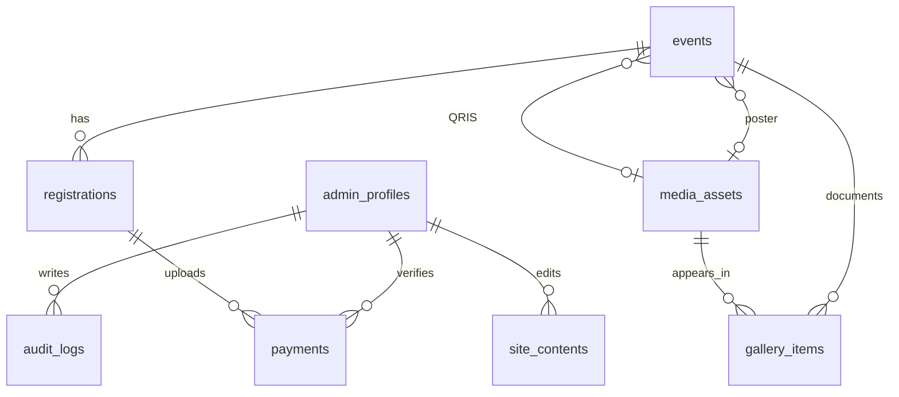

# Architecture & Development Plan — Berbagi Kebahagiaan

## Scope
Single community, one super admin, guest participants, free/paid events, proof upload on same paid registration form, manual QRIS, web-only status, filtered Excel export, CMS, analytics, deployment to an existing domain.

## Final technology
- Next.js App Router + React + TypeScript
- Tailwind CSS v4 + Lucide icons, Montserrat heading and Poppins body
- Supabase PostgreSQL, Auth (admin only), Storage (private payment proofs), RLS
- Scheduled expiry: Supabase Cron invoking a protected server-side job or restricted SQL function
- ExcelJS server-side XLSX export
- Vercel, existing domain (name not yet provided)

## Architecture
1. Browser public components → Next.js Server Components + `/api/registrations`.
2. Admin browsers → cookie-based Supabase Auth → authenticated Next.js route handlers/server actions.
3. Server receives paid multipart registration, validates fields and image content (MIME and actual signature), limits size (e.g. 5 MB), uploads proof to private bucket, calls PostgreSQL `create_registration_with_proof` atomic RPC using server-only secret; if RPC fails, deletes orphaned upload.
4. RPC locks event row, checks state/time/capacity, inserts registration/payment, and increments reserved_count in one transaction.
5. Expiry job marks expired and releases quota; admin verification must use an atomic server-side function and follow event-first locking order. If payment was valid but expiry ran, use a manual reconciliation workflow, not silent confirmation beyond capacity.
6. Public check-status uses code + OTP/email verification or sufficiently strong secret lookup token; since no email notifications are requested, consider code + participant email AND rate-limit with masking and CAPTCHA. Code-only is **not secure**.
7. All list/detail/read operations of private participant data are server-gated. RLS denies anon read access to registrations/payments.
8. Admin Excel export: `GET /api/admin/events/:eventId/participants.xlsx`, verify auth + super admin, filter event_id on server, sort by registration date, return XLSX with safe spreadsheet-escaped text and no proof URLs. ExcelJS supports this; paging/batched queries for large events.
9. Analytics compute from actual rows, with payments verified state separate from registration confirmed state.

## Event registration behavior
- FREE: submit form; server validates duplicate, capacity, deadlines; create CONFIRMED, reserve one seat.
- PAID: fill participant data, view real QRIS, upload proof in same form, submit once; only successful backend transaction reserves seat. Await review; no payment success assumption.
- When pending review TTL expires, release quota. User sees EXPIRED; internal reconciliation needed if bank records prove payment received.
- For duplicate registrations, reject or direct user to status lookup. Admin can cancel and release seat.
- If file upload succeeds but RPC fails, remove the uploaded object.

## Database ERD

See `supabase/migrations/001_initial.sql` for field-level schema.

## Next.js target routes
Public: `/`, `/about`, `/events`, `/events/[slug]`, `/events/[slug]/register`, `/gallery`, `/contact`, `/status`.
Admin: `/admin/login`, `/admin/dashboard`, `/admin/events`, `/admin/participants`, `/admin/payments`, `/admin/content`, `/admin/analytics`, `/admin/settings`.
Backend: `/api/registrations`, `/api/registration-status`, `/api/admin/events/[eventId]/participants.xlsx`.

## Release stages
**1. Foundation (this starter):** setup, design tokens, public demo pages, protected admin scaffolding, SQL schema. No live signup yet.
**2. Admin auth + real events:** Supabase Auth, one admin profile, proxy cookie refresh, admin route guards, events CRUD and posters.
**3. Guest registration:** single-page paid proof upload, atomic quota, expiry job, duplicate guard, secure status lookup, QRIS.
**4. Operations:** admin queue verification, participant filtering + Excel export, cancellation and audit.
**5. Content & insights:** CMS, gallery, media permission, analytics.
**6. Production:** accessibility, security tests, load/concurrency tests, backups, domain + HTTPS + SEO.

## Security checklist
- Secret key only in server runtime, never `NEXT_PUBLIC_`.
- Private bucket + signed read URLs for admin with expiry.
- Never use user-supplied amounts or reserve counts.
- Configure request size limits, file sniffing, virus scanning policy, abuse limits and CAPTCHA if traffic warrants.
- Normalize emails, idempotency keys for repeated network submissions, strict event locks.
- Signed and audited payment review; event-first locks for release/update to prevent deadlocks.
- Expiry cron must be transactional, idempotent, and exclude verified registrations.
- Manual bank reconciliation required before approving payments.
- Official QRIS assets and verified recipient identity before production.
- Content privacy, children photo consent, minimization and retention policy.
- Admin XLSX export should sanitize formula-leading strings (`= + - @`) to avoid spreadsheet injection.

## UI source observations
The provided HTML is a single-file interactive prototype, using Tailwind CDN, inline JS, `appState` arrays, mode-switch admin access, dummy QRIS SVG and sample data. It is suitable as visual inspiration only. Public and admin design components need to become separate Next.js routes. Avoid importing prototype's sample phone, email, QRIS merchant, volunteer count or sample event data into production without verification.

## Outstanding external inputs (not blocking development)
- Existing domain name and its DNS provider
- Actual QRIS image and merchant identity
- Approved community logo and documentation photos
- Initial admin email
- Final payment review expiry and reconciliation policy
